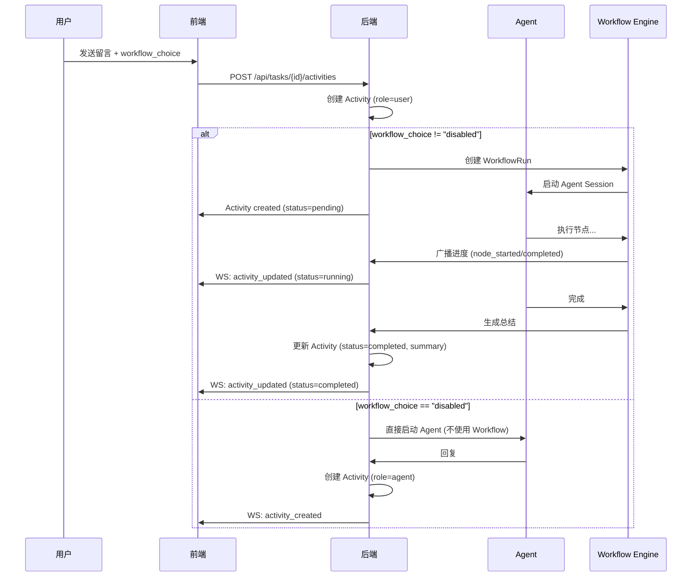

# 对话式任务系统设计

> **设计日期**: 2026-11-12  
> **目标**: 将任务从"阶段式"重构为"对话式"，Workflow 作为 Agent 内部工具

---

## 一、设计目标

### 1.1 用户视角

**从**：
```
任务 = 多个阶段（Stage 1, Stage 2...）
用户需要编辑每个阶段，手动推进
```

**到**：
```
任务 = 对话流
用户发留言 → Agent 自动选择 Workflow 执行 → 回复结果
就像和 Agent 对话一样自然
```

### 1.2 核心原则

1. **对话是主体**：任务详情面板呈现留言流，不是阶段列表
2. **Workflow 是工具**：像 bash、文件操作一样，是 Agent 的能力
3. **进度可见但不突兀**：执行中显示简单进度，完成后显示总结
4. **详情按需深入**：永久的"查看详情"按钮可以展开 Workflow 执行细节

---

## 二、架构设计

### 2.1 概念模型

```
任务 (Task)
├─ 基本信息 (name, status, root_id)
├─ 初始输入 (initial_input) - 创建任务时的描述
└─ 活动流 (Activities)
    ├─ 用户留言 (UserMessage)
    ├─ Agent 回复 (AgentReply)
    │   ├─ 状态 (pending/running/completed/failed)
    │   ├─ 总结文本 (summary)
    │   ├─ 关联的 WorkflowRun (可选)
    │   └─ 关联的 Session (可选)
    └─ 系统事件 (SystemEvent) - 如状态变更
```

### 2.2 执行流程



---

## 三、数据模型

### 3.1 核心表结构

#### 3.1.1 `task_activities` (新增)

任务的活动流，包含用户留言和 Agent 回复。

```sql
CREATE TABLE task_activities (
    id TEXT PRIMARY KEY,                      -- UUID
    task_id TEXT NOT NULL,                    -- 关联任务
    root_id TEXT NOT NULL,                    -- 冗余，便于跨项目查询
    
    -- 活动类型
    type TEXT NOT NULL,                       -- 'user_message' | 'agent_reply' | 'system_event'
    role TEXT NOT NULL,                       -- 'user' | 'agent' | 'system'
    
    -- 内容
    body TEXT NOT NULL,                       -- 留言文本
    author TEXT,                              -- 用户名（user_message）
    
    -- Agent 回复专属字段
    status TEXT,                              -- 'pending' | 'running' | 'completed' | 'failed' | 'cancelled'
    summary TEXT,                             -- 完成后的总结文本
    
    -- 关联资源
    workflow_run_id TEXT,                     -- 关联的 WorkflowRun
    workflow_version_id TEXT,                 -- 使用的 Workflow 版本
    workflow_choice TEXT,                     -- 'empty' | 'specified' | 'disabled'
    session_key TEXT,                         -- 关联的会话
    
    -- 元数据
    created_at INTEGER NOT NULL,              -- Unix timestamp (ms)
    updated_at INTEGER NOT NULL,
    
    FOREIGN KEY (task_id) REFERENCES tasks(id) ON DELETE CASCADE
);

CREATE INDEX idx_task_activities_task ON task_activities(task_id, created_at);
CREATE INDEX idx_task_activities_workflow_run ON task_activities(workflow_run_id);
```

#### 3.1.2 `workflows` 表增强

增加元数据字段，支持自动选择。

```sql
ALTER TABLE workflows ADD COLUMN description TEXT;      -- 描述
ALTER TABLE workflows ADD COLUMN use_cases TEXT;        -- 使用场景（JSON 数组）
ALTER TABLE workflows ADD COLUMN tags TEXT;             -- 标签（JSON 数组）
ALTER TABLE workflows ADD COLUMN auto_select_enabled INTEGER DEFAULT 1; -- 是否允许自动选择
```

**示例数据**：
```json
{
  "id": "workflow-debug",
  "name": "调试工作流",
  "description": "定位和修复代码 bug",
  "use_cases": [
    "代码报错需要定位原因",
    "功能不符合预期需要调试",
    "测试失败需要分析问题"
  ],
  "tags": ["debug", "troubleshoot", "fix"],
  "auto_select_enabled": true
}
```

#### 3.1.3 `workflow_runs` 表增强

```sql
ALTER TABLE workflow_runs ADD COLUMN triggered_by TEXT; -- 'user' | 'agent_auto' | 'scheduled'
ALTER TABLE workflow_runs ADD COLUMN activity_id TEXT;  -- 关联的 Activity
```

### 3.2 历史任务处理

**不改变现有表结构**，只改变呈现方式：

- `tasks.task_stages_json` 保留
- `stage_runs` 表保留
- 前端检测到有 `task_stages_json` 时，生成"历史任务视图"：
  - 主界面：提取最后的结果生成"总结留言"
  - 折叠区：显示原有的阶段列表（只读）

---

## 四、API 设计

### 4.1 Activity 相关

#### 4.1.1 获取任务活动流

```http
GET /api/tasks/{taskId}/activities
```

**Query 参数**：
- `node_id` (可选): 节点 ID

**响应**：
```json
{
  "activities": [
    {
      "id": "act_xxx",
      "type": "user_message",
      "role": "user",
      "body": "请修复登录 bug",
      "author": "张三",
      "created_at": 1699876543210
    },
    {
      "id": "act_yyy",
      "type": "agent_reply",
      "role": "agent",
      "status": "completed",
      "body": "正在执行调试工作流...",
      "summary": "已定位到 auth.ts 第 42 行的 null 检查缺失，已修复并通过测试。",
      "workflow_run_id": "run_zzz",
      "workflow_version_id": "v1",
      "session_key": "session_aaa",
      "created_at": 1699876543250,
      "updated_at": 1699876600100
    }
  ]
}
```

#### 4.1.2 提交新留言

```http
POST /api/tasks/{taskId}/activities
Content-Type: application/json

{
  "body": "请添加单元测试",
  "workflow_choice": "empty",        // 'empty' | 'specified' | 'disabled'
  "workflow_version_id": null        // 指定时必填
}
```

**响应**：
```json
{
  "user_activity": {
    "id": "act_new_user",
    "type": "user_message",
    "body": "请添加单元测试",
    "created_at": 1699876700000
  },
  "agent_activity": {
    "id": "act_new_agent",
    "type": "agent_reply",
    "status": "pending",
    "workflow_run_id": "run_new",
    "created_at": 1699876700050
  }
}
```

#### 4.1.3 获取 Activity 详情

```http
GET /api/tasks/{taskId}/activities/{activityId}
```

**响应**：单个 Activity 对象（含关联的 WorkflowRun 摘要）

### 4.2 Workflow 选择相关

#### 4.2.1 获取可用 Workflows

```http
GET /api/workflows/available
```

**Query 参数**：
- `user_input` (可选): 用户输入，用于 AI 匹配推荐

**响应**：
```json
{
  "workflows": [
    {
      "id": "workflow-debug",
      "name": "调试工作流",
      "description": "定位和修复代码 bug",
      "tags": ["debug", "fix"],
      "recommended": true,          // AI 推荐
      "match_score": 0.85           // 匹配分数
    }
  ]
}
```

#### 4.2.2 AI 推荐 Workflow

```http
POST /api/workflows/recommend
Content-Type: application/json

{
  "user_input": "登录功能报错了",
  "task_context": {               // 可选：任务上下文
    "task_id": "task_xxx",
    "previous_activities": []
  }
}
```

**响应**：
```json
{
  "recommended": {
    "workflow_id": "workflow-debug",
    "reason": "用户描述包含'报错'关键词，匹配调试场景"
  },
  "alternatives": [
    {
      "workflow_id": "workflow-blank",
      "reason": "通用工作流"
    }
  ]
}
```

### 4.3 WebSocket 事件

#### 4.3.1 Activity 创建

```json
{
  "type": "task.activity.created",
  "payload": {
    "task_id": "task_xxx",
    "activity": { /* Activity 对象 */ }
  }
}
```

#### 4.3.2 Activity 更新

```json
{
  "type": "task.activity.updated",
  "payload": {
    "task_id": "task_xxx",
    "activity_id": "act_xxx",
    "changes": {
      "status": "running",
      "summary": "正在执行第 2/5 步..."
    }
  }
}
```

---

## 五、前端设计

### 5.1 组件树

```
TaskDetailPanel (主面板)
├─ PanelShell (现有)
│   ├─ Header (任务名、状态、操作按钮)
│   └─ Body
│       ├─ InitialInputCard (初始输入，只读)
│       ├─ ActivityStream (活动流) ⭐ 核心
│       │   ├─ UserMessageCard
│       │   ├─ AgentReplyCard ⭐
│       │   │   ├─ StatusIndicator (pending/running/completed/failed)
│       │   │   ├─ ProgressView (running 时显示)
│       │   │   ├─ SummaryView (completed 时显示)
│       │   │   └─ ViewDetailsButton (永久可见)
│       │   └─ SystemEventCard
│       └─ ActivityInput (新留言输入框) ⭐
│           ├─ WorkflowSelector (empty/specified/disabled)
│           ├─ TextInput
│           └─ SendButton
│
└─ WorkflowRunDrawer (详情抽屉，按需打开)
    ├─ DrawerShell
    └─ RunTimeline (复用现有)
        ├─ NodeList
        └─ NodeDetails
            └─ SessionLink (跳转会话)
```

### 5.2 核心组件设计

#### 5.2.1 `ActivityStream`

**职责**：渲染任务的活动流

**Props**：
```typescript
interface ActivityStreamProps {
  taskId: string;
  rootId: string;
  nodeId?: string;
  activities: TaskActivity[];
  onOpenSession: (sessionKey: string) => void;
}
```

**渲染逻辑**：
```typescript
activities.map(activity => {
  switch (activity.type) {
    case 'user_message':
      return <UserMessageCard activity={activity} />
    case 'agent_reply':
      return <AgentReplyCard 
        activity={activity}
        onViewDetails={() => openDrawer(activity.workflow_run_id)}
        onOpenSession={onOpenSession}
      />
    case 'system_event':
      return <SystemEventCard activity={activity} />
  }
})
```

#### 5.2.2 `AgentReplyCard`

**职责**：渲染 Agent 回复，根据状态显示不同内容

**Props**：
```typescript
interface AgentReplyCardProps {
  activity: TaskActivity;
  onViewDetails: () => void;
  onOpenSession: (sessionKey: string) => void;
}
```

**渲染逻辑**：
```typescript
function AgentReplyCard({ activity, onViewDetails, onOpenSession }) {
  const { status, summary, workflow_run_id, session_key } = activity;
  
  return (
    <Card align="left" highlight>
      <Header>
        <AgentIcon />
        <StatusBadge status={status} />
        <Timestamp />
      </Header>
      
      <Body>
        {status === 'pending' && <PendingView />}
        {status === 'running' && <ProgressView activity={activity} />}
        {status === 'completed' && <SummaryView summary={summary} />}
        {status === 'failed' && <ErrorView activity={activity} />}
      </Body>
      
      <Actions>
        {workflow_run_id && (
          <Button onClick={onViewDetails}>查看执行详情 →</Button>
        )}
        {session_key && (
          <Button onClick={() => onOpenSession(session_key)}>
            打开会话
          </Button>
        )}
      </Actions>
    </Card>
  );
}
```

#### 5.2.3 `ProgressView`

**职责**：显示 Workflow 执行进度

```typescript
function ProgressView({ activity }: { activity: TaskActivity }) {
  // 从 workflow_run_id 获取实时进度
  const run = useWorkflowRun(activity.workflow_run_id);
  
  if (!run) return <Spinner />;
  
  const { current_node, total_nodes, nodes } = run;
  const currentNodeInfo = nodes.find(n => n.id === current_node);
  
  return (
    <div className="progress-view">
      <ProgressBar current={current_node} total={total_nodes} />
      <div className="current-step">
        步骤 {current_node}/{total_nodes}: {currentNodeInfo?.name}
      </div>
      {currentNodeInfo?.status === 'running' && (
        <div className="step-detail">
          {currentNodeInfo.description}
        </div>
      )}
    </div>
  );
}
```

#### 5.2.4 `ActivityInput`

**职责**：输入新留言，选择 Workflow

**Props**：
```typescript
interface ActivityInputProps {
  taskId: string;
  onSend: (body: string, choice: WorkflowChoice, versionId?: string) => Promise<void>;
  sending: boolean;
}
```

**渲染**：
```typescript
function ActivityInput({ taskId, onSend, sending }) {
  const [body, setBody] = useState('');
  const [choice, setChoice] = useState<WorkflowChoice>('empty');
  const [versionId, setVersionId] = useState('');
  const [aiRecommendation, setAiRecommendation] = useState(null);
  
  // AI 推荐（debounce）
  useEffect(() => {
    if (body.trim() && choice === 'empty') {
      debouncedRecommend(body).then(setAiRecommendation);
    }
  }, [body, choice]);
  
  return (
    <div className="activity-input">
      {/* Workflow 选择器 */}
      <WorkflowSelector
        choice={choice}
        versionId={versionId}
        recommendation={aiRecommendation}
        onChange={(c, v) => { setChoice(c); setVersionId(v); }}
      />
      
      {/* 输入框 */}
      <textarea
        value={body}
        onChange={e => setBody(e.target.value)}
        placeholder="输入你的需求..."
      />
      
      {/* 发送按钮 */}
      <button
        disabled={sending || !body.trim()}
        onClick={() => onSend(body, choice, versionId)}
      >
        发送
      </button>
    </div>
  );
}
```

#### 5.2.5 `WorkflowSelector`

**职责**：选择 Workflow 模式

```typescript
function WorkflowSelector({ choice, versionId, recommendation, onChange }) {
  const [showPicker, setShowPicker] = useState(false);
  const { data: workflows } = useAvailableWorkflows();
  
  return (
    <div className="workflow-selector">
      {/* 三态按钮组 */}
      <div role="radiogroup">
        <button
          role="radio"
          aria-checked={choice === 'empty'}
          onClick={() => onChange('empty', '')}
        >
          自动选择
          {recommendation && (
            <Chip>推荐: {recommendation.workflow_name}</Chip>
          )}
        </button>
        
        <button
          role="radio"
          aria-checked={choice === 'specified'}
          onClick={() => setShowPicker(true)}
        >
          指定工作流
        </button>
        
        <button
          role="radio"
          aria-checked={choice === 'disabled'}
          onClick={() => onChange('disabled', '')}
        >
          禁用工作流
        </button>
      </div>
      
      {/* 工作流选择弹窗 */}
      {showPicker && (
        <WorkflowPickerDialog
          workflows={workflows}
          selected={versionId}
          onSelect={(id) => { 
            onChange('specified', id);
            setShowPicker(false);
          }}
          onClose={() => setShowPicker(false)}
        />
      )}
    </div>
  );
}
```

### 5.3 历史任务视图

**适配策略**：检测 `task.task_stages_json` 是否存在

```typescript
function TaskDetailPanel({ detail, ... }) {
  const hasLegacyStages = detail.task.task_stages_json?.length > 0;
  
  if (hasLegacyStages) {
    return <LegacyTaskView detail={detail} ... />;
  }
  
  return <ConversationTaskView detail={detail} ... />;
}
```

**LegacyTaskView**：
```typescript
function LegacyTaskView({ detail }) {
  const [showStages, setShowStages] = useState(false);
  
  // 从最后的 stage_run 提取总结
  const summary = extractSummaryFromStageRuns(detail.stage_runs);
  
  return (
    <PanelShell>
      {/* 初始输入 */}
      <InitialInputCard input={detail.initial_input} />
      
      {/* 生成的总结留言 */}
      <AgentReplyCard
        activity={{
          type: 'agent_reply',
          role: 'agent',
          status: detail.task.status,
          summary: summary,
          body: '(历史任务)',
        }}
      />
      
      {/* 折叠的阶段详情 */}
      <Collapsible
        title="查看执行详情（历史阶段视图）"
        open={showStages}
        onToggle={() => setShowStages(!showStages)}
      >
        {detail.stages.map((stage, i) => (
          <StageCard key={i} stage={stage} run={detail.stage_runs[i]} />
        ))}
      </Collapsible>
    </PanelShell>
  );
}
```

---

## 六、后端实现

### 6.1 核心服务

#### 6.1.1 `ActivityService`

**职责**：管理任务活动流

```go
package kanban

type ActivityService struct {
    store *ActivityStore
    workflowService *WorkflowService
    sessionManager *session.Manager
}

// CreateUserActivity 创建用户留言并触发 Agent 响应
func (s *ActivityService) CreateUserActivity(
    ctx context.Context,
    taskID string,
    body string,
    workflowChoice string,
    workflowVersionID *string,
) (*UserActivity, *AgentActivity, error) {
    // 1. 创建用户留言
    userAct := &TaskActivity{
        ID:        uuid.New().String(),
        TaskID:    taskID,
        Type:      "user_message",
        Role:      "user",
        Body:      body,
        CreatedAt: time.Now(),
    }
    if err := s.store.Insert(userAct); err != nil {
        return nil, nil, err
    }
    
    // 2. 触发 Agent 响应
    var agentAct *TaskActivity
    
    if workflowChoice == "disabled" {
        // 直接启动 Agent，不使用 Workflow
        agentAct = s.startDirectAgent(ctx, taskID, body)
    } else {
        // 使用 Workflow
        var wfID string
        if workflowChoice == "specified" && workflowVersionID != nil {
            wfID = *workflowVersionID
        } else {
            // AI 自动选择
            wfID = s.recommendWorkflow(ctx, body)
        }
        
        agentAct = s.startWorkflowRun(ctx, taskID, body, wfID, userAct.ID)
    }
    
    return userAct, agentAct, nil
}

// startWorkflowRun 启动 WorkflowRun 并创建关联的 AgentActivity
func (s *ActivityService) startWorkflowRun(
    ctx context.Context,
    taskID string,
    userInput string,
    workflowVersionID string,
    triggeredByActivityID string,
) *TaskActivity {
    // 创建 WorkflowRun
    run, err := s.workflowService.CreateRun(ctx, &CreateRunRequest{
        WorkflowVersionID: workflowVersionID,
        TaskID:            taskID,
        Input:             userInput,
        TriggeredBy:       "user",
    })
    if err != nil {
        return s.createErrorActivity(taskID, err)
    }
    
    // 创建 AgentActivity
    agentAct := &TaskActivity{
        ID:                uuid.New().String(),
        TaskID:            taskID,
        Type:              "agent_reply",
        Role:              "agent",
        Body:              "正在执行工作流...",
        Status:            "pending",
        WorkflowRunID:     &run.ID,
        WorkflowVersionID: &workflowVersionID,
        WorkflowChoice:    "empty", // 或 "specified"
        CreatedAt:         time.Now(),
        UpdatedAt:         time.Now(),
    }
    
    s.store.Insert(agentAct)
    
    // 异步启动执行
    go s.executeWorkflowRun(ctx, run.ID, agentAct.ID)
    
    return agentAct
}

// executeWorkflowRun 执行 WorkflowRun 并更新 Activity
func (s *ActivityService) executeWorkflowRun(ctx context.Context, runID, activityID string) {
    // 更新状态为 running
    s.updateActivityStatus(activityID, "running", "")
    
    // 执行 Workflow
    result, err := s.workflowService.Execute(ctx, runID)
    
    if err != nil {
        s.updateActivityStatus(activityID, "failed", err.Error())
        return
    }
    
    // 生成总结
    summary := s.generateSummary(result)
    
    // 更新为 completed
    s.updateActivityStatus(activityID, "completed", summary)
}

// recommendWorkflow AI 推荐 Workflow
func (s *ActivityService) recommendWorkflow(ctx context.Context, userInput string) string {
    // 调用 LLM 进行匹配
    workflows, _ := s.workflowService.ListAvailable(ctx)
    
    prompt := fmt.Sprintf(`
用户输入: %s

可用工作流:
%s

请根据用户输入推荐最合适的工作流 ID。
`, userInput, s.formatWorkflowsForPrompt(workflows))
    
    // 调用 Claude API
    response := s.callClaude(prompt)
    
    return response.WorkflowID
}
```

#### 6.1.2 `WorkflowService` 增强

```go
// ListAvailable 获取可用的 Workflows（带元数据）
func (s *WorkflowService) ListAvailable(ctx context.Context) ([]*WorkflowMeta, error) {
    rows, err := s.store.Query(`
        SELECT id, name, description, use_cases, tags, auto_select_enabled
        FROM workflows
        WHERE auto_select_enabled = 1
        ORDER BY name
    `)
    // ...
}

// Recommend 推荐 Workflow
func (s *WorkflowService) Recommend(ctx context.Context, req *RecommendRequest) (*RecommendResponse, error) {
    // 实现 AI 推荐逻辑
}
```

### 6.2 WebSocket 广播

```go
// 在 WorkflowRun 执行过程中广播更新
func (s *ActivityService) onNodeStarted(runID, nodeID string) {
    activity := s.store.GetByWorkflowRunID(runID)
    if activity == nil {
        return
    }
    
    // 更新 Activity 的 body（进度文本）
    run := s.workflowService.GetRun(runID)
    currentNode := run.GetNode(nodeID)
    progressText := fmt.Sprintf("步骤 %d/%d: %s", 
        currentNode.Index, 
        len(run.Nodes), 
        currentNode.Name,
    )
    
    s.store.UpdateBody(activity.ID, progressText)
    
    // 广播
    s.hub.Broadcast(&WSMessage{
        Type: "task.activity.updated",
        Payload: map[string]interface{}{
            "task_id":     activity.TaskID,
            "activity_id": activity.ID,
            "changes": map[string]interface{}{
                "body": progressText,
            },
        },
    })
}
```

---

## 七、实施计划

### Phase 1: Workflow Metadata 系统 (2 天)

**目标**：让 Workflow 可以被自动选择

**任务**：
1. ✅ 数据库迁移：`workflows` 表增加 `description`、`use_cases`、`tags` 字段
2. ✅ 后端 API：
   - `GET /api/workflows/available` - 获取可用 Workflows
   - `POST /api/workflows/recommend` - AI 推荐
3. ✅ 前端组件：`WorkflowSelector` 基础版（三态按钮）
4. ✅ 测试：推荐逻辑单元测试

**验收标准**：
- 可以手动指定 Workflow
- AI 推荐能返回合理的 Workflow ID

---

### Phase 2: Activity 系统与执行模型 (3 天)

**目标**：建立对话式的执行模型

**任务**：
1. ✅ 数据库迁移：创建 `task_activities` 表
2. ✅ 后端服务：
   - `ActivityService` - 核心业务逻辑
   - `POST /api/tasks/{id}/activities` - 提交留言
   - `GET /api/tasks/{id}/activities` - 获取活动流
3. ✅ WorkflowRun 增强：
   - 增加 `triggered_by`、`activity_id` 字段
   - 执行完成后生成总结
4. ✅ WebSocket 事件：
   - `task.activity.created`
   - `task.activity.updated`
5. ✅ 测试：
   - Activity 创建流程
   - Workflow 执行与状态更新

**验收标准**：
- 提交留言后自动创建 WorkflowRun
- 执行过程中状态实时更新
- 完成后生成总结文本

---

### Phase 3: 前端重构 (4 天)

**目标**：对话式任务详情面板

**任务**：
1. ✅ 核心组件：
   - `ActivityStream` - 活动流容器
   - `UserMessageCard` - 用户留言卡片
   - `AgentReplyCard` - Agent 回复卡片
   - `ProgressView` - 进度显示
   - `SummaryView` - 总结显示
2. ✅ 输入组件：
   - `ActivityInput` - 留言输入框
   - `WorkflowSelector` - Workflow 选择器（完整版）
   - `WorkflowPickerDialog` - Workflow 选择弹窗
3. ✅ 详情抽屉：
   - `WorkflowRunDrawer` - 复用现有 RunTimeline
4. ✅ 数据层：
   - `useTaskActivities` - 活动流 hook
   - `useWorkflowRun` - WorkflowRun 实时数据
5. ✅ 集成：
   - 替换 `TaskDetailPanel` 主体
   - WebSocket 事件监听

**验收标准**：
- 对话式界面正常显示
- 可以发送留言并看到 Agent 回复
- 进度实时更新
- 可以展开查看详情

---

### Phase 4: 历史任务适配 (2 天)

**目标**：兼容现有的阶段式任务

**任务**：
1. ✅ 检测逻辑：判断 `task_stages_json` 是否存在
2. ✅ `LegacyTaskView` 组件：
   - 提取总结文本
   - 折叠的阶段列表
3. ✅ 总结生成：
   - 从 `stage_runs` 提取最终结果
   - 格式化为对话式文本
4. ✅ 测试：
   - 历史任务正常显示
   - 可以展开查看阶段

**验收标准**：
- 历史任务显示总结留言
- 可以展开查看原阶段列表
- 不影响新任务的创建

---

### Phase 5: 优化与抛光 (2 天)

**目标**：体验优化

**任务**：
1. ✅ 性能优化：
   - 活动流虚拟滚动（如果数量大）
   - WebSocket 消息去重
2. ✅ 交互优化：
   - Loading 状态
   - 错误提示
   - 空状态
3. ✅ 国际化：
   - 所有新增文案
4. ✅ 测试补全：
   - E2E 测试
   - 边界情况

---

## 八、风险与缓解

### 8.1 数据迁移风险

**风险**：现有任务无法平滑过渡

**缓解**：
- 历史任务只改展示，不改数据
- 新旧系统并存一段时间
- 提供"转换为新格式"的手动选项

### 8.2 AI 推荐准确性

**风险**：推荐的 Workflow 不合适

**缓解**：
- 用户可以手动指定
- 推荐结果显示原因
- 收集反馈持续优化

### 8.3 性能问题

**风险**：活动流过长导致卡顿

**缓解**：
- 虚拟滚动
- 分页加载
- WebSocket 消息节流

### 8.4 向后兼容

**风险**：破坏现有功能

**缓解**：
- Phase 4 专门处理历史任务
- 保留原有数据结构
- 完整的回归测试

---

## 九、未来扩展

### 9.1 批量操作

- 一次留言触发多个 Workflow
- 并行执行

### 9.2 条件执行

- 根据上一个结果决定是否执行
- 支持分支逻辑

### 9.3 模板留言

- 常用请求的快捷模板
- 支持变量替换

### 9.4 历史记录搜索

- 搜索任务中的留言
- 按时间/状态/Workflow 过滤

---

## 十、总结

### 10.1 核心变化

| 维度 | 旧设计 | 新设计 |
|------|--------|--------|
| **结构** | 阶段式（Stage 1, 2, 3...） | 对话式（留言流） |
| **交互** | 手动编辑阶段、推进 | 发送留言，Agent 自动执行 |
| **Workflow** | 无 | Agent 的内部工具 |
| **进度** | 当前阶段 | 实时进度 + 总结 |
| **详情** | 主界面展示所有阶段 | 按需展开详情抽屉 |

### 10.2 用户价值

1. **更自然的交互**：像聊天一样使用任务系统
2. **自动化执行**：Agent 自动选择合适的 Workflow
3. **清晰的进度**：实时看到执行状态
4. **灵活的控制**：可以手动指定或禁用 Workflow

### 10.3 技术债务

- 历史任务的总结生成是"尽力而为"，不保证完美
- AI 推荐依赖 LLM，有成本和延迟
- 需要维护两套渲染逻辑（新任务 vs 历史任务）

---

**设计完成，等待批准。**
